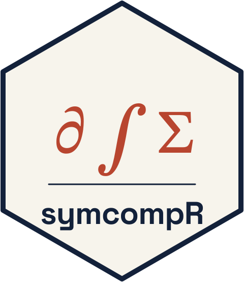

# symcompR: Symbolic Computation in R 

<!-- badges: start -->
[](https://github.com/adamrsophie/symcompR/actions/workflows/R-CMD-check.yaml)
[](https://github.com/adamrsophie/symcompR/actions/workflows/test-coverage.yaml)
[](https://adamrsophie.github.io/symcompR/)
[](https://lifecycle.r-lib.org/articles/stages.html#experimental)
[](https://www.gnu.org/licenses/gpl-3.0)
<!-- DOI badge: Zenodo mints a concept DOI on the first GitHub release; replace XXXXXXXX and uncomment. -->
<!-- [](https://doi.org/10.5281/zenodo.XXXXXXXX) -->
<!-- Software Heritage archives public repositories only; uncomment once the repository is public. -->
<!-- [](https://archive.softwareheritage.org/browse/origin/?origin_url=https://github.com/adamrsophie/symcompR) -->
<!-- badges: end -->

***symcompR*** is a computer algebra system written in R. It is a native port
of the Python library [SymPy](https://www.sympy.org): expressions are R
objects, exact integers and rationals come from
[gmp](https://CRAN.R-project.org/package=gmp), and every algorithm runs in R.
There is no Python, no `reticulate`, and no compiled code.

Results follow SymPy closely, down to the order in which terms print, so code
and answers move between the two systems with little translation. Outputs are
checked against SymPy itself (see [Validation](#validation)).

symcompR covers exact arithmetic and automatic simplification, assumptions,
differentiation, series and limits, integration and integral transforms,
polynomial algebra and factorization, algebraic number theory, equation,
inequality, ODE, PDE, recurrence and Diophantine solvers, matrices and matrix
expressions, number theory, combinatorics and group theory, logic, sets,
geometry, vectors, tensors, physical units, parsers for SymPy, LaTeX and
Mathematica input, and printers for LaTeX, MathML, two dimensional text, and
code in thirteen languages.

## Installation

```r
# Development version
# install.packages("remotes")
remotes::install_github("adamrsophie/symcompR")
```

symcompR needs R 4.3.0 or later and the `gmp` package. It contains no compiled
code, so no C or C++ toolchain is required.

## Quick start

```r
library(symcompR)
x <- Symbol("x"); y <- Symbol("y")
n <- Symbol("n", integer = TRUE)
f <- Function("f")

expand((x + y)^3)
#> x^3 + 3*x^2*y + 3*x*y^2 + y^3

sym_factor(x^4 - 1)
#> (x - 1)*(x + 1)*(x^2 + 1)

diff(sin(x) * exp(x), x)
#> exp(x)*sin(x) + exp(x)*cos(x)

sym_integrate(exp(-x^2), list(x, -Inf, Inf))
#> sqrt(pi)

limit(sin(x) / x, x, 0)
#> 1

series(tan(x), x, 0, 8)
#> x + x^3/3 + 2*x^5/15 + 17*x^7/315 + O(x^8)

solveset(sin(x) - Rational(1, 2), x, Reals)
#> Union(ImageSet(Lambda(_n, 2*_n*pi + pi/6), Integers), ImageSet(Lambda(_n, 2*_n*pi + 5*pi/6), Integers))

dsolve(Eq(diff(f(x), x, 2) + f(x), 0), f(x))
#> Eq(f(x), C1*sin(x) + C2*cos(x))

summation(1/n^2, list(n, 1, Inf))
#> pi^2/6

M <- Matrix(list(list(1, 2), list(3, 4)))
inverse(M)
#> Matrix(2, 2)
#> [-2 , 1   ]
#> [3/2, -1/2]

latex(Integral(exp(-x^2), list(x, -Inf, Inf)))
#> \int\limits_{- \infty}^{\infty} e^{- x^{2}}\, dx

ccode(sqrt(x) + Rational(1, 3))
#> sqrt(x) + 1.0/3.0

pprint((x + 1)/(y - 2) + sqrt(x^2 + 1), use_unicode = FALSE)
#>            ________
#> x + 1     /  2
#> ----- + \/  x  + 1
#> y - 2
```

## What is covered

| Area | Highlights |
|------|------------|
| Core | Exact `Integer` and `Rational` arithmetic, canonical `Add`/`Mul`/`Pow`, assumptions, `subs`, `xreplace`, `expand` and its hints, `factor_terms`, arbitrary precision evaluation with `N()` |
| Functions | Elementary, gamma family, error and exponential integrals, zeta, Bessel, Airy, elliptic, orthogonal polynomials, `Piecewise`, B-splines |
| Calculus | `diff`, `limit`, `series`, `summation`, `product`, finite differences, singularities, extrema, monotonicity, periodicity, `AccumBounds` interval arithmetic, `not_empty_in` |
| Integration | Heuristic and rational function integration, definite integrals, Laplace, Fourier, Mellin, sine, cosine and Hankel transforms |
| Polynomials | Sparse polynomials over QQ and GF(p), factorization (Zassenhaus, Hensel, Wang's multivariate EEZ, algebraic and Gaussian domains), GCDs, Groebner bases, resultants, roots to degree four, `CRootOf`, `galois_group` to degree six |
| Algebraic number theory | Number fields, `round_two` integral bases, `prime_decomp`, `prime_valuation`, `PrimeIdeal` |
| Solvers | `solve`, `solveset` with periodic families, linear and polynomial systems, inequalities, `dsolve`, `pdsolve`, `rsolve`, `diophantine`, `nsolve` |
| Simplification | `simplify`, `trigsimp`, the Fu et al. trigonometric rules (`fu`, `TR0` to `TR22`), `powsimp`, `radsimp`, `signsimp`, `collect`, `nsimplify`, `gammasimp`, `hypersimp` |
| Matrices | Dense symbolic matrices, determinants, inverses, eigenvalues, Jordan form, LU, QR, Cholesky, Hermite and Smith normal forms; matrix expressions (`MatrixSymbol`, `BlockMatrix`, `MatrixSlice`, `blockcut`, `block_collapse`) |
| Number theory | Primality, `factorint` (Pollard rho and p - 1, ECM, quadratic sieve), residues, discrete logarithms, CRT, continued fractions |
| Sets and logic | Intervals, finite sets, `ImageSet`, `ConditionSet`, `Range`, ordinals; normal forms, Quine-McCluskey, DPLL satisfiability; assumptions with `ask`, `refine`, and `assuming` |
| Series objects | Sequences, linear recurrences, Pade approximants, Fourier series |
| Combinatorics and groups | Permutations, permutation groups (Schreier-Sims, Sylow subgroups, cosets), free and finitely presented groups (Todd-Coxeter, Reidemeister-Schreier, rewriting systems, homomorphisms), polycyclic groups, polyhedra |
| Vectors and tensors | `sympy.vector` (`CoordSys3D`, del operators, dyadics, parametric regions and integrals), tensor canonicalization (`canon_bp`), `TensorHead` algebra, `PartialDerivative`, arrays |
| Physics | `sympy.physics.units`: unit systems (SI, MKS, MKSA, natural, CGS Gauss), `convert_to`, dimensional analysis, physical constants |
| Parsing | `parse_expr` with SymPy's transformations, `parse_latex`, `parse_mathematica` |
| Other modules | Geometry in 2D and 3D, statistics, discrete transforms, quaternions, plotting |
| Printing | `str`, `srepr`, LaTeX, MathML, 2D pretty printing, `TableForm`, and code for C, C++, Fortran, JavaScript, Julia, Mathematica, Maple, Octave, R, Python, Rust, GLSL, and SMT-LIB |

Coverage is a work in progress: 867 of the 901 names in SymPy's top level
API (96 percent) are available, counted by name. A ported function can still
handle fewer input classes than its SymPy counterpart. Python classes and
exceptions with no R meaning (`Basic`, `Expr`, `PolynomialError`, domain
objects such as `ZZ`) are not planned.

## Differences from SymPy

- Powers print and parse as `^`, not `**`.
- `==` is structural equality, as in SymPy; build equations with `Eq()`.
- Write `Rational(1, 3)`, not `1/3`: R evaluates `1/3` to a double first.
- Floats have arbitrary precision, as in SymPy: `N(sym_pi, 50)` gives 50
  significant digits, and the default is 15.
- Constants whose names clash with R are `sym_pi`, `sym_E`, and `sym_I`.
- Attaching symcompR masks no base R function, and a test enforces this.
  SymPy names that clash with base R carry a `sym_` prefix: `sym_factor()`,
  `sym_integrate()`, `sym_symbols()`, `sym_var()`, `sym_det()`,
  `sym_factorial()`, `sym_beta()`, `sym_binomial()`, `sym_atan2()`,
  `sym_Mod()` (or `x %% y`), `sym_ordered()`, `sym_poly()`, `sym_rf()`,
  `sym_lcm()`, `sym_fft()`, `sym_decompose()`, `sym_trunc()`, `sym_prod()`,
  `sym_reshape()`, `sym_diag()`, and `sym_trace()`. Where base R has a generic
  (`diff`, `sin`, `exp`, `pretty`, `scale`, `t`, ...), symcompR adds an S3
  method instead.

## Validation

- Expected values in the test suite come from SymPy, pinned to commit
  `86150a81`, run as an oracle on the same inputs.
- Larger modules have dedicated differential test harnesses against SymPy:
  the Diophantine solver matches SymPy on 52 of 53 equations (the last differs
  only in its error message), and the number theory module is compared
  function by function.
- `R CMD check --as-cran` passes with no errors, warnings, or notes.

## Citing symcompR

```r
citation("symcompR")
```

The repository ships machine readable citation and software metadata for FAIR
harvesters:

- [`CITATION.cff`](CITATION.cff): Citation File Format (GitHub "Cite this
  repository", Zenodo).
- [`codemeta.json`](codemeta.json): CodeMeta 2.0 software metadata crosswalk.
- [`.zenodo.json`](.zenodo.json): Zenodo deposit metadata (author,
  license, related identifiers).
- [`ro-crate-metadata.json`](ro-crate-metadata.json): RO-Crate 1.1 packaging
  and provenance.
- `inst/CITATION`: the R level citation (`citation("symcompR")`).
- `inst/COPYRIGHTS` and `inst/SYMPY-LICENSE`: provenance and the license of the
  ported SymPy code.

All carry the GPL-3.0 SPDX identifier, the author, and the SymPy
provenance. Once the first GitHub release is archived on Zenodo, its concept
DOI will resolve to the latest release.

## Contributing

Bug reports, feature requests, and pull requests are welcome; see
[`CONTRIBUTING.md`](CONTRIBUTING.md). A wrong answer is the most useful bug
report: include the input and, if you can, what SymPy returns for it. Please
follow the [Code of Conduct](CODE_OF_CONDUCT.md), and report security issues
privately as described in [`SECURITY.md`](SECURITY.md).

## Author

- Adam R Sophie (author, maintainer, copyright holder),
  <adamrsophie@gmail.com>

## Acknowledgments

symcompR is a port of [SymPy](https://github.com/sympy/sympy), and its design,
algorithms, and expected outputs follow SymPy. The SymPy Development Team is
gratefully acknowledged; SymPy is distributed under the BSD 3-Clause License,
whose notice is retained in `inst/SYMPY-LICENSE` as it requires. symcompR is
not affiliated with or endorsed by the SymPy project.

## License

GPL-3. See [`LICENSE.md`](LICENSE.md) or
<https://www.gnu.org/licenses/gpl-3.0> for the full license text. The portions
derived from SymPy remain under SymPy's BSD 3-Clause License; see
`inst/COPYRIGHTS`.
