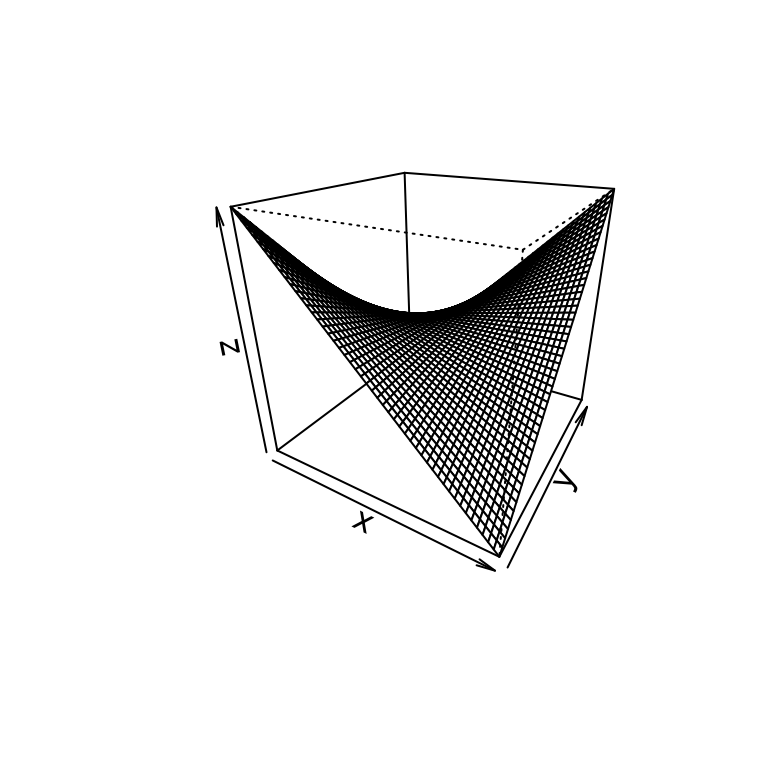

# Statistics, discrete transforms, and utilities

This vignette collects the smaller modules: symbolic random variables,
discrete transforms and convolutions, elliptic curves, plotting, and the
iteration and programming utilities.

``` r

library(symcompR)
z <- Symbol("z")
```

## Random variables

symcompR includes a subset of `sympy.stats`. Random variables are
symbols with a distribution; expectations, variances, densities, and
probabilities are computed symbolically. This module is under active
development, so the examples below stick to single random variables and
sums of expectations.

``` r

mu <- Symbol("mu", real = TRUE); s <- Symbol("s", positive = TRUE)
X <- Normal("X", mu, s)
E(X)
#> mu
E(X^2)
#> mu^2 + s^2
variance(2 * X + 1)
#> 4*s^2
std(X)
#> s
```

For the standard normal distribution:

``` r

Y <- Normal("Y", 0, 1)
rv_density(Y, z)
#> sqrt(2)*exp(-z^2/2)/(2*sqrt(pi))
rv_cdf(Y, z)
#> erf(sqrt(2)*z/2)/2 + 1/2
P(Gt(Y, 0))
#> 1/2
kurtosis(Y)
#> 3
```

Other continuous distributions:

``` r

lam <- Symbol("lambda", positive = TRUE)
Tx <- Exponential("T", lam)
E(Tx)
#> 1/lambda
variance(Tx)
#> lambda^(-2)
P(Gt(Tx, 1))
#> exp(-lambda)
skewness(Tx)
#> 2
U <- Uniform("U", 0, 1)
variance(U)
#> 1/12
```

Discrete distributions:

``` r

D <- Die("D", 6)
E(D)
#> 7/2
variance(D)
#> 35/12
P(Gt(D, 4))
#> 1/3
E(D + Die("D2", 6))
#> 7
E(Binomial("B", 10, Rational(1, 3)))
#> 10/3
variance(Binomial("B", 10, Rational(1, 3)))
#> 20/9
E(Poisson("K", lam))
#> lambda
```

More distributions, with their parameters given as symbols or numbers.
[`GammaRV()`](https://adamrsophie.github.io/symcompR/reference/Normal.md)
and
[`BetaRV()`](https://adamrsophie.github.io/symcompR/reference/Normal.md)
are the gamma and beta distributions, named so that they do not mask the
gamma and beta functions.

``` r

kk <- Symbol("k", positive = TRUE); th <- Symbol("theta", positive = TRUE)
al <- Symbol("alpha", positive = TRUE); be <- Symbol("beta", positive = TRUE)
E(GammaRV("G", kk, th))
#> k*theta
variance(GammaRV("G", kk, th))
#> k*theta^2
E(BetaRV("Bt", al, be))
#> alpha/(alpha + beta)
E(ChiSquared("C", 4))
#> 4
variance(ChiSquared("C", 4))
#> 8
rv_density(StudentT("St", 2), z)
#> sqrt(2)/(4*(z^2/2 + 1)^(3/2))
rv_density(Cauchy("Cy", 0, 1), z)
#> 1/(pi*(z^2 + 1))
rv_density(LogNormal("L", 0, 1), z)
#> sqrt(2)*exp(-log(z)^2/2)/(2*sqrt(pi)*z)
E(Weibull("W", 1, 2))
#> sqrt(pi)/2
E(Pareto("Pa", 1, 3))
#> 3/2
variance(Laplace("La", 0, 2))
#> 8
E(Bernoulli("Be", Rational(1, 3)))
#> 1/3
E(Geometric("Ge", Rational(1, 4)))
#> 4
```

[`moment()`](https://adamrsophie.github.io/symcompR/reference/Normal.md)
and
[`cmoment()`](https://adamrsophie.github.io/symcompR/reference/Normal.md)
are raw and central moments,
[`covariance()`](https://adamrsophie.github.io/symcompR/reference/Normal.md)
and
[`correlation()`](https://adamrsophie.github.io/symcompR/reference/Normal.md)
relate two variables, and
[`expectation()`](https://adamrsophie.github.io/symcompR/reference/Normal.md)
is a synonym of
[`E()`](https://adamrsophie.github.io/symcompR/reference/Normal.md).
[`rv_sample()`](https://adamrsophie.github.io/symcompR/reference/Normal.md)
draws random values with R’s random number generator.

``` r

moment(Die("D", 6), 2)
#> 91/6
cmoment(Die("D", 6), 2)
#> 35/12
X0 <- Normal("X0", 0, 1); X1 <- Normal("X1", 0, 1)
covariance(X0, 2 * X0)
#> 2
covariance(X0, X1)
#> 0
correlation(X0, 2 * X0 + 1)
#> 1
expectation(X0^2 + 3)
#> 4
set.seed(1)
length(rv_sample(X0, 3))
#> [1] 3
```

## Discrete transforms and convolutions

[`convolution()`](https://adamrsophie.github.io/symcompR/reference/convolution.md)
computes linear or cyclic convolutions of exact sequences. These
functions return lists, printed here on one line with
[`sstr()`](https://adamrsophie.github.io/symcompR/reference/sstr.md).
The fast Fourier transform
[`sym_fft()`](https://adamrsophie.github.io/symcompR/reference/convolution.md),
the number theoretic transform
[`ntt()`](https://adamrsophie.github.io/symcompR/reference/ntt.md)
(modulo a prime of the form c \cdot 2^k + 1), the Walsh-Hadamard
transform
[`fwht()`](https://adamrsophie.github.io/symcompR/reference/discrete-aliases.md),
and the Möbius transform are exact as well.

``` r

show <- function(l) vapply(l, sstr, "")
show(convolution(1:3, 4:5))
#> [1] "4"  "13" "22" "15"
show(convolution(1:3, 4:5, cycle = 3))
#> [1] "19" "13" "22"
F <- sym_fft(list(1, 2, 3, 4))
show(F)
#> [1] "10"       "-2 - 2*I" "-2"       "-2 + 2*I"
show(sym_ifft(F))
#> [1] "1" "2" "3" "4"
ntt(c(1, 2, 3, 5), 3 * 2^8 + 1)
#> [1]  11 581 766 184
intt(ntt(c(1, 2, 3, 5), 769), 769)
#> [1] 1 2 3 5
show(fwht(list(4, 2, 2, 0)))
#> [1] "8" "4" "4" "0"
show(mobius_transform(list(1, 2, 3, 4)))
#> [1] "1"  "3"  "4"  "10"
show(covering_product(list(1, 2), list(3, 4)))
#> [1] "3"  "18"
show(ifft(list(1, 2, 3, 4)))
#> [1] "5/2"        "-1/2 + I/2" "-1/2"       "-1/2 - I/2"
show(ifwht(list(4, 2, 2, 0)))
#> [1] "2" "1" "1" "0"
show(intersecting_product(c(1, 2, 3, 4), c(5, 6, 7, 8)))
#> [1] "103" "52"  "73"  "32"
```

## Cryptography

The ciphers and key exchange protocols of `sympy.crypto` have their own
vignette,
[`vignette("cryptography", package = "symcompR")`](https://adamrsophie.github.io/symcompR/articles/cryptography.md).

## Elliptic curves

`EllipticCurve(a4, a6)` is the curve y^2 = x^3 + a_4 x + a_6. Points add
with the chord and tangent law.

``` r

e <- EllipticCurve(-1, 9)
e$discriminant
#> [1] -34928
e$point(0, 3) + e$point(-1, 3)
#> (1, -3)
```

## Plotting

[`plot()`](https://rdrr.io/r/graphics/plot.default.html) draws an
expression with base R graphics, and
[`plot_parametric()`](https://adamrsophie.github.io/symcompR/reference/plot.sym.md),
[`plot_implicit()`](https://adamrsophie.github.io/symcompR/reference/plot.sym.md),
and
[`plot3d()`](https://adamrsophie.github.io/symcompR/reference/plot.sym.md)
draw parametric curves, implicit curves, and surfaces.

``` r

x <- Symbol("x")
plot(sin(x) / x, list(x, -10, 10))
```


``` r

t <- Symbol("t"); y <- Symbol("y")
plot_parametric(cos(3 * t), sin(2 * t), list(t, 0, 2 * sym_pi))
```


``` r

plot_implicit(x^2 + y^2 - 1, list(x, -1.5, 1.5), list(y, -1.5, 1.5))
```


``` r

plot3d(x * y, list(x, -1, 1), list(y, -1, 1))
```



## Iteration utilities

`sympy.utilities.iterables` provides many generators for combinatorial
enumeration (see also the combinatorics vignette).

``` r

flat <- function(l) vapply(l, paste, character(1), collapse = " ")
flat(multiset_permutations(c(1, 1, 2)))
#> [1] "1 1 2" "1 2 1" "2 1 1"
flat(generate_bell(3))
#> [1] "0 1 2" "0 2 1" "2 0 1" "2 1 0" "1 2 0" "1 0 2"
flat(permute_signs(c(0, 1, 2)))
#> [1] "0 1 2"   "0 -1 2"  "0 1 -2"  "0 -1 -2"
flat(runs(c(0, 1, 2, 2, 1, 4, 3, 2, 3)))
#> [1] "0 1 2" "2"     "1 4"   "3"     "2 3"
unlist(flatten(list(list(1, 2), list(3, list(4)))))
#> [1] 1 2 3 4
ibin(5, 4)
#> [1] 0 1 0 1
```

`generate_bell(n)` lists the permutations of 0, \ldots, n - 1 such that
consecutive ones differ by swapping two neighbors, and
[`runs()`](https://adamrsophie.github.io/symcompR/reference/iterables.md)
splits a sequence into increasing runs.

More helpers from `sympy.utilities.iterables`:
[`sift()`](https://adamrsophie.github.io/symcompR/reference/iterables.md)
splits by a key,
[`group()`](https://adamrsophie.github.io/symcompR/reference/iterables.md)
collects runs of equal elements,
[`has_dups()`](https://adamrsophie.github.io/symcompR/reference/iterables.md)
and
[`has_variety()`](https://adamrsophie.github.io/symcompR/reference/iterables.md)
test a sequence,
[`rotations()`](https://adamrsophie.github.io/symcompR/reference/iterables.md),
[`prefixes()`](https://adamrsophie.github.io/symcompR/reference/iterables.md),
and
[`postfixes()`](https://adamrsophie.github.io/symcompR/reference/iterables.md)
list its rotations and ends,
[`unflatten()`](https://adamrsophie.github.io/symcompR/reference/iterables.md)
regroups it,
[`variations()`](https://adamrsophie.github.io/symcompR/reference/iterables.md)
lists ordered selections,
[`take()`](https://adamrsophie.github.io/symcompR/reference/iterables.md)
returns the first elements,
[`dict_merge()`](https://adamrsophie.github.io/symcompR/reference/iterables.md)
merges named lists, and
[`topological_sort()`](https://adamrsophie.github.io/symcompR/reference/iterables.md)
orders the vertices of a directed acyclic graph so that every edge
points forward.

``` r

str(sift(1:5, function(v) v %% 2))
#> List of 2
#>  $ 0: int [1:2] 2 4
#>  $ 1: int [1:3] 1 3 5
flat(group(c(1, 1, 2, 2, 2, 3)))
#> [1] "1 1"   "2 2 2" "3"
flat(lapply(group(c(1, 1, 2, 2, 2, 3), multiple = FALSE), unlist))
#> [1] "1 2" "2 3" "3 1"
c(has_dups(c(1, 2, 1)), has_variety(c(1, 1, 1)))
#> [1]  TRUE FALSE
flat(rotations(c(1, 2, 3)))
#> [1] "1 2 3" "2 3 1" "3 1 2"
flat(prefixes(c(1, 2, 3)))
#> [1] "1"     "1 2"   "1 2 3"
flat(postfixes(c(1, 2, 3)))
#> [1] "3"     "2 3"   "1 2 3"
flat(unflatten(c(1, 2, 3, 4, 5, 6), 3))
#> [1] "1 2 3" "4 5 6"
flat(variations(c(1, 2, 3), 2))
#> [1] "1 2" "1 3" "2 1" "2 3" "3 1" "3 2"
flat(variations(c(1, 2), 2, repetition = TRUE))
#> [1] "1 1" "1 2" "2 1" "2 2"
take(0:9, 3)
#> [1] 0 1 2
str(dict_merge(list(a = 1, b = 2), list(b = 3, c = 4)))
#> List of 3
#>  $ a: num 1
#>  $ b: num 3
#>  $ c: num 4
topological_sort(c(4, 3, 1, 2), list(c(1, 2), c(2, 3), c(1, 3), c(3, 4)))
#> [1] 1 2 3 4
```

## Programming utilities

[`capture()`](https://adamrsophie.github.io/symcompR/reference/utility-helpers.md)
returns what a function prints,
[`filldedent()`](https://adamrsophie.github.io/symcompR/reference/utility-helpers.md)
reflows an indented string,
[`memoize_property()`](https://adamrsophie.github.io/symcompR/reference/utility-helpers.md)
caches a one argument function, and
[`public()`](https://adamrsophie.github.io/symcompR/reference/utility-helpers.md)
marks a function as public (it returns it unchanged).
[`threaded()`](https://adamrsophie.github.io/symcompR/reference/utility-helpers.md)
makes a function act elementwise on matrices and on both sides of an
equation, and on the terms of a sum;
[`xthreaded()`](https://adamrsophie.github.io/symcompR/reference/utility-helpers.md)
does the same but leaves sums whole.
[`timed()`](https://adamrsophie.github.io/symcompR/reference/utility-helpers.md)
measures how long a function takes.

``` r

capture(function() print(x^2))
#> [1] "x^2\n"
filldedent("
      This text is indented
      in the source.")
#> [1] "\nThis text is indented in the source."
sq_cached <- memoize_property(function(v) v^2)
sq_cached(3)
#> [1] 9
identical(public(sin), sin)
#> [1] TRUE
sq_th <- threaded(function(e) e^2)
sq_th(Matrix(list(list(x, 1))))
#> Matrix(1, 2)
#> [x^2, 1]
sq_th(Eq(x, 2))
#> Eq(x^2, 4)
sq_th(x + 1)
#> x^2 + 1
xthreaded(function(e) e^2)(x + 1)
#> (x + 1)^2
names(timed(function() sum(1:10)))
#> [1] "number" "time"   "scaled" "unit"
```

[`init_printing()`](https://adamrsophie.github.io/symcompR/reference/interactive-session.md)
chooses the default printer for the session (`"pretty"` for two
dimensional output, `"latex"`, or `"str"`), and
[`init_session()`](https://adamrsophie.github.io/symcompR/reference/interactive-session.md)
also creates the usual symbols `x`, `y`, `z`, `t`, the integer symbols
`k`, `m`, `n`, and the functions `f`, `g`, `h`.
[`interactive_traversal()`](https://adamrsophie.github.io/symcompR/reference/interactive-session.md)
walks an expression tree interactively, so it is not run here.

``` r

old <- options(symcompR.print = NULL)
init_printing(pretty_print = TRUE)
x^2 / 2
#>  2
#> x 
#> ──
#> 2
init_session(quiet = TRUE)
f(k) + n
#> n + f(k)
options(old)
x^2 / 2
#> x^2/2
```
