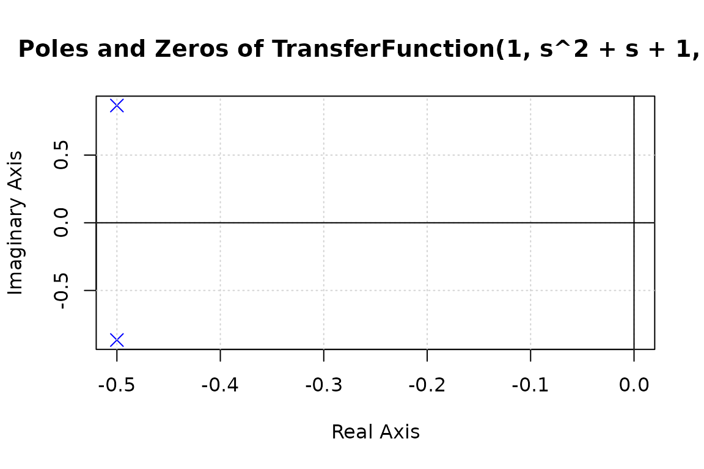
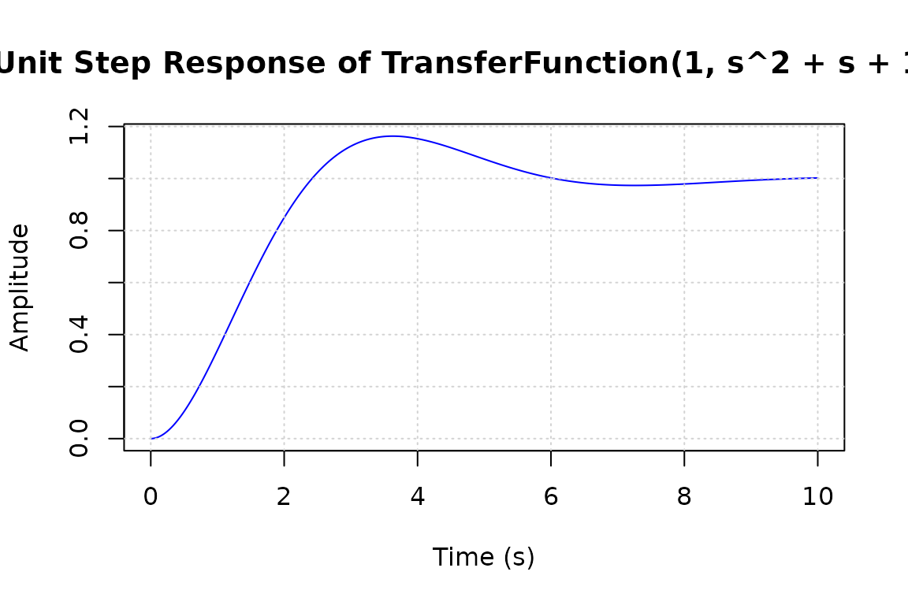
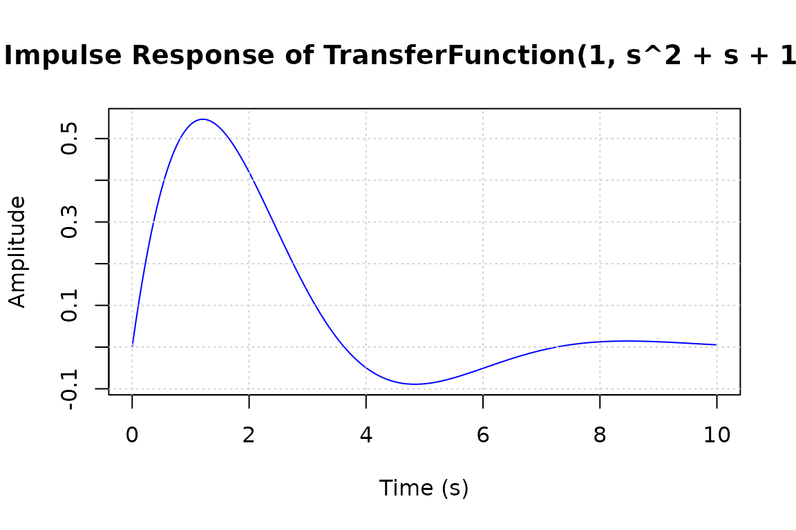
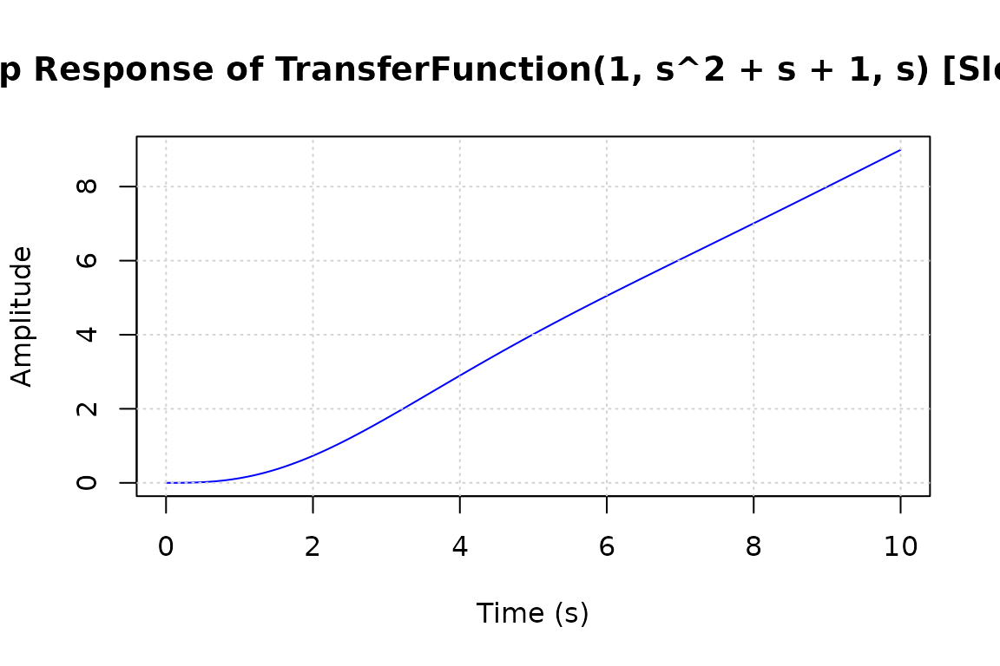
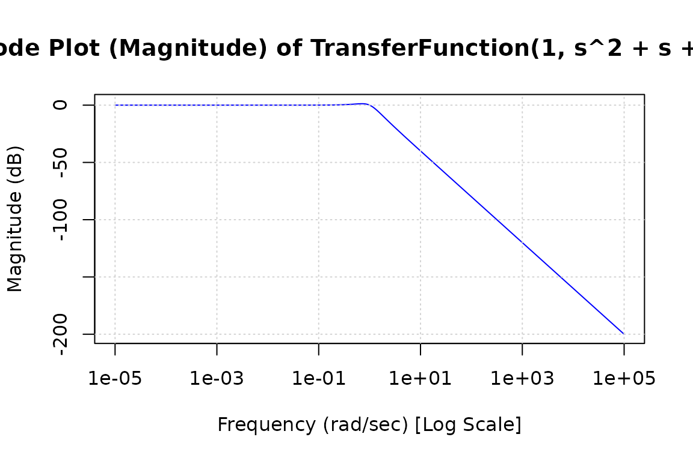
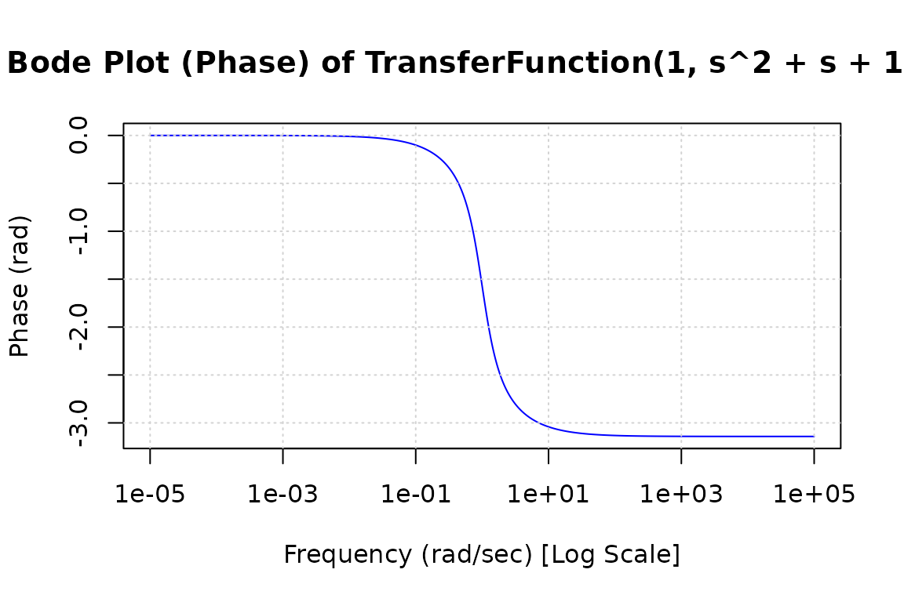
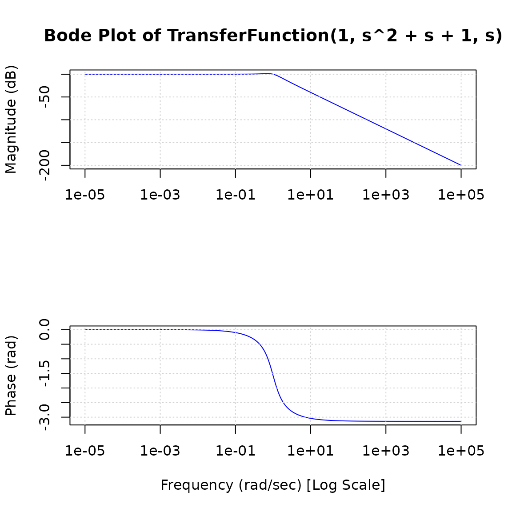
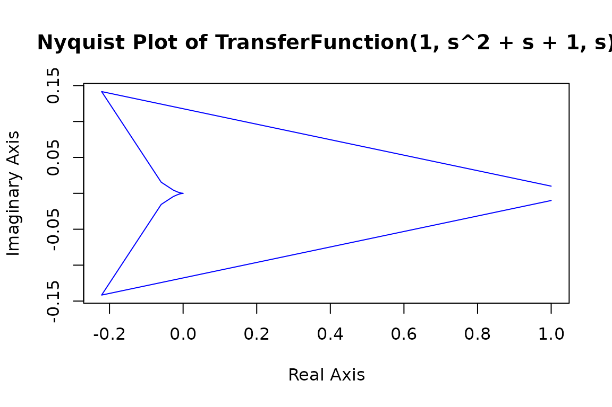
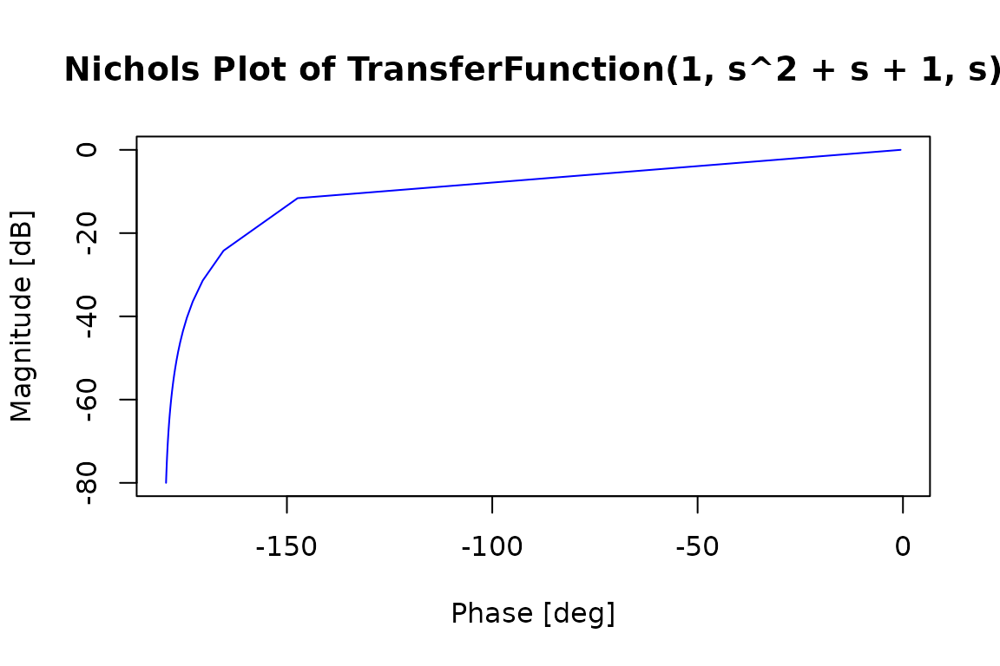

# Optics, control and continuum mechanics

This vignette covers three engineering modules of `sympy.physics`:
`optics` (ray and Gaussian beam optics, media, waves and polarization),
`control` (transfer functions, state space models and their responses)
and `continuum_mechanics` (beams, columns, trusses, cables and arches).
Objects are used through `$`, as fields and methods, like their SymPy
counterparts.

``` r

library(symcompR)
a <- Symbol("a"); b <- Symbol("b"); d <- Symbol("d"); f <- Symbol("f")
h <- Symbol("h"); s <- Symbol("s"); z <- Symbol("z"); x <- Symbol("x")
```

## Ray transfer matrices

Paraxial optical elements are 2 \times 2 ray transfer matrices; a ray is
a column of its height and angle. Matrices compose with `%*%`.

``` r

ThinLens(f) %*% FreeSpace(d)
#> Matrix(2, 2)
#> [1   , d       ]
#> [-1/f, -d/f + 1]
FreeSpace(d) %*% GeometricRay(h, Symbol("angle"))
#> Matrix(2, 1)
#> [angle*d + h]
#> [angle      ]
GeometricRay(h, Symbol("angle"))$height
#> h
rtm <- RayTransferMatrix(1, 2, 3, 4)
rtm
#> Matrix(2, 2)
#> [1, 2]
#> [3, 4]
rtm$A
#> 1
FlatRefraction(1, 2)
#> Matrix(2, 2)
#> [1, 0  ]
#> [0, 1/2]
CurvedRefraction(Symbol("R"), 1, 2)
#> Matrix(2, 2)
#> [1       , 0  ]
#> [-1/(2*R), 1/2]
FlatMirror()
#> Matrix(2, 2)
#> [1, 0]
#> [0, 1]
CurvedMirror(Symbol("R"))
#> Matrix(2, 2)
#> [1   , 0]
#> [-2/R, 1]
```

## Gaussian beams

`BeamParameter(wavelen, z, w = ...)` is the complex beam parameter of a
Gaussian beam.

``` r

p <- BeamParameter(530e-9, 1, w = 1e-3)
p$q
#> 1 + 1.88679245283019*I*pi
p$z_r
#> 1.88679245283019*pi
N(p$w_0)
#> 0.00100000000000000
N(p$divergence)
#> 0.000168704239677409
waist2rayleigh(Symbol("w"), Symbol("wavelen"))
#> pi*w^2/wavelen
rayleigh2waist(Symbol("z_r"), Symbol("wavelen"))
#> sqrt(wavelen*z_r)/sqrt(pi)
```

Conjugation relations of geometric and Gaussian optics:

``` r

geometric_conj_ab(a, b)
#> a*b/(a + b)
geometric_conj_af(a, f)
#> a*f/(a - f)
geometric_conj_bf(b, f)
#> b*f/(b - f)
gaussian_conj(Symbol("s_in"), Symbol("z_r_in"), f)[[1]]
#> 1/(-1/(s_in + z_r_in^2/(-f + s_in)) + 1/f)
conjugate_gauss_beams(Symbol("l"), Symbol("w_i"), Symbol("w_o"), f = f)[[1]]
#> f*(1 - sqrt(w_i^2/w_o^2 - pi^2*w_i^4/(f^2*l^2)))
```

## Media, waves and optics formulas

``` r

Medium("vacuum")$refractive_index
#> 1
m2 <- Medium("m", n = 2)
m2$refractive_index
#> 2
m2$speed
#> 149896229*meter/second
w1 <- TWave(Symbol("A1"), f, Symbol("phi1"))
w2 <- TWave(Symbol("A2"), f, Symbol("phi2"))
(w1 + w2)$amplitude
#> sqrt(A1^2 + 2*A1*A2*cos(phi1 - phi2) + A2^2)
w1$rewrite("cos")
#> A1*cos(-2*pi*f*t + phi1 + pi*second*f*n*x/(149896229*meter))
w1$wavelength
#> 299792458*meter/(second*f*n)
w1$angular_velocity
#> 2*pi*f
```

Refraction, reflection, lenses and mirrors:

``` r

refraction_angle(0.5, 1, 2)
#> 0.242069983487306
refraction_angle(list(1, 1, 1), 1, 1, list(0, 0, 1))
#> Matrix(3, 1)
#> [1 ]
#> [1 ]
#> [-1]
critical_angle(1.33, 1)
#> 0.850908514477849
brewster_angle(1, 1.33)
#> 0.926093295503462
fresnel_coefficients(0.3, 1, 2)
#> [[1]]
#> 0.317843553417859
#> 
#> [[2]]
#> -0.348645229818821
#> 
#> [[3]]
#> 0.658921776708929
#> 
#> [[4]]
#> 0.651354770181179
deviation(0.3, 1, 2)
#> -0.151696868812430
lens_formula(focal_length = f, u = Symbol("u"))
#> f*u/(f + u)
lens_makers_formula(1.33, 1, 10, -10)
#> 15.1515151515151
mirror_formula(u = oo, v = Symbol("v"))
#> v
hyperfocal_distance(0.5, 8, 0.0015)
#> 20.8333333333333
transverse_magnification(30, 15)
#> -2
```

## Polarization

Jones vectors and matrices, Stokes vectors and Mueller matrices:

``` r

jones_vector(0, 0)
#> Matrix(2, 1)
#> [1]
#> [0]
jones_vector(sym_pi / 4, sym_pi / 8)
#> Matrix(2, 1)
#> [sqrt(2)*sqrt(sqrt(2)/4 + 1/2)/2 - sqrt(2)*I*sqrt(1/2 - sqrt(2)/4)/2]
#> [sqrt(2)*sqrt(sqrt(2)/4 + 1/2)/2 + sqrt(2)*I*sqrt(1/2 - sqrt(2)/4)/2]
stokes_vector(0, 0)
#> Matrix(4, 1)
#> [1]
#> [1]
#> [0]
#> [0]
jones_2_stokes(jones_vector(0, sym_pi / 4))
#> Matrix(4, 1)
#> [1]
#> [0]
#> [0]
#> [1]
linear_polarizer(Symbol("theta"))
#> Matrix(2, 2)
#> [cos(theta)^2         , sin(theta)*cos(theta)]
#> [sin(theta)*cos(theta), sin(theta)^2         ]
mueller_matrix(linear_polarizer(0))
#> Matrix(4, 4)
#> [1/2, 1/2, 0, 0]
#> [1/2, 1/2, 0, 0]
#> [0  , 0  , 0, 0]
#> [0  , 0  , 0, 0]
half_wave_retarder(0)
#> Matrix(2, 2)
#> [-I, 0]
#> [0 , I]
quarter_wave_retarder(0)
#> Matrix(2, 2)
#> [exp(-I*pi/4), 0             ]
#> [0           , I*exp(-I*pi/4)]
phase_retarder(0, Symbol("delta"))
#> Matrix(2, 2)
#> [exp(-I*delta/2), 0             ]
#> [0              , exp(I*delta/2)]
transmissive_filter(Symbol("T"))
#> Matrix(2, 2)
#> [sqrt(T), 0      ]
#> [0      , sqrt(T)]
reflective_filter(Symbol("R"))
#> Matrix(2, 2)
#> [sqrt(R), 0       ]
#> [0      , -sqrt(R)]
polarizing_beam_splitter()
#> Matrix(4, 4)
#> [1, 0 , 0, 0 ]
#> [0, 0 , 0, -I]
#> [0, 0 , 1, 0 ]
#> [0, -I, 0, 0 ]
half_wave_retarder(sym_pi / 4) %*% jones_vector(0, 0)
#> Matrix(2, 1)
#> [0 ]
#> [-I]
```

## Transfer functions

`TransferFunction(num, den, var)` is a single input, single output
system.
[`create_transfer_function()`](https://adamrsophie.github.io/symcompR/reference/create_transfer_function.md)
builds a continuous or (with a sampling time) discrete transfer
function.

``` r

G <- TransferFunction(s + 1, s^2 + 2, s)
G
#> TransferFunction(s + 1, s^2 + 2, s)
G$poles()
#> [[1]]
#> sqrt(2)*I
#> 
#> [[2]]
#> -sqrt(2)*I
TransferFunction(s + 1, s^2 - 1, s)$zeros()
#> [[1]]
#> -1
G$is_stable()
#> [1] FALSE
G$to_expr()
#> (s + 1)/(s^2 + 2)
TransferFunction(1, s + 1, s)$dc_gain()
#> 1
G * TransferFunction(1, s, s)
#> Series(TransferFunction(s + 1, s^2 + 2, s), TransferFunction(1, s, s))
TransferFunction$from_rational_expression((s + 1) / (s^2 - 1), s)
#> TransferFunction(s + 1, s^2 - 1, s)
TransferFunction(s + 1, s^2 - 1, s)$simplify()
#> TransferFunction(1, s - 1, s)
create_transfer_function(s + 1, s^2 + 2, s)
#> TransferFunction(s + 1, s^2 + 2, s)
create_transfer_function(z, z + 1, z, 0.1)
#> DiscreteTransferFunction(z, z + 1, z, 0.1)
DiscreteTransferFunction(z, z + 1, z, 0.1)
#> DiscreteTransferFunction(z, z + 1, z, 0.1)
```

Interconnections and a PID controller:

``` r

G1 <- TransferFunction(1, s + 1, s); G2 <- TransferFunction(s, s + 2, s)
Series(G1, G2)
#> Series(TransferFunction(1, s + 1, s), TransferFunction(s, s + 2, s))
Series(G1, G2)$doit()
#> TransferFunction(s, (s + 1)*(s + 2), s)
Parallel(G1, G2)$doit()
#> TransferFunction(s*(s + 1) + s + 2, (s + 1)*(s + 2), s)
Feedback(G1, G2)
#> Feedback(TransferFunction(1, s + 1, s), TransferFunction(s, s + 2, s), -1)
Feedback(G1, G2)$doit()
#> TransferFunction((s + 1)*(s + 2), (s + 1)*(s + (s + 1)*(s + 2)), s)
PIDController(1, 2, 3, 0, s)$doit()
#> TransferFunction(3*s^2 + s + 2, s, s)
```

`TransferFunctionBase` is the abstract base class of the transfer
functions and cannot be instantiated:

``` r

trimws(tryCatch(TransferFunctionBase(1, s, s), error = conditionMessage))
#> [1] "The TransferFunctionBase class is not meant to be used directly."
```

Discretization by the generalized bilinear transform:
[`gbt()`](https://adamrsophie.github.io/symcompR/reference/gbt.md) with
parameter `alpha`, and its special cases
[`bilinear()`](https://adamrsophie.github.io/symcompR/reference/gbt.md)
(Tustin),
[`forward_diff()`](https://adamrsophie.github.io/symcompR/reference/gbt.md)
and
[`backward_diff()`](https://adamrsophie.github.io/symcompR/reference/gbt.md).
Each returns the numerator and denominator coefficients.

``` r

Ts <- Symbol("T")
G0 <- TransferFunction(1, s + 1, s)
gbt(G0, Ts, S(1) / 2)
#> ([T/(2*(T/2 + 1)), T/(2*(T/2 + 1))], [1, (T/2 - 1)/(T/2 + 1)])
bilinear(G0, Ts)
#> ([T/(2*(T/2 + 1)), T/(2*(T/2 + 1))], [1, (T/2 - 1)/(T/2 + 1)])
forward_diff(G0, Ts)
#> ([T], [1, T - 1])
backward_diff(G0, Ts)
#> ([T/(T + 1), 0], [1, -1/(T + 1)])
gain_margin(TransferFunction(1, s^3 + 2 * s^2 + 2 * s + 1, s))
#> 20*log(3)/log(10)
```

The Routh Hurwitz table decides stability from the characteristic
polynomial:

``` r

RouthHurwitz(s^4 + s^3 + 3 * s^2 + 3 * s + 3, s)
#> Matrix(5, 3)
#> [1 , 3, 3]
#> [1 , 3, 0]
#> [-3, 3, 0]
#> [4 , 0, 0]
#> [3 , 0, 0]
```

Transfer function matrices describe systems with several inputs and
outputs:

``` r

M <- TransferFunctionMatrix(list(list(G1, G2), list(G2, G1)))
M
#> TransferFunctionMatrix(((TransferFunction(1, s + 1, s), TransferFunction(s, s + 2, s)), (TransferFunction(s, s + 2, s), TransferFunction(1, s + 1, s))))
M$shape
#> (2, 2)
MIMOSeries(TransferFunctionMatrix(list(list(G1), list(G2))),
           TransferFunctionMatrix(list(list(G1, G2))))$doit()
#> TransferFunctionMatrix(((TransferFunction(s^2*(s + 1)^2 + (s + 2)^2, (s + 1)^2*(s + 2)^2, s),),))
MIMOParallel(TransferFunctionMatrix(list(list(G1, G2))),
             TransferFunctionMatrix(list(list(G2, G1))))$doit()
#> TransferFunctionMatrix(((TransferFunction(s*(s + 1) + s + 2, (s + 1)*(s + 2), s), TransferFunction(s*(s + 1) + s + 2, (s + 1)*(s + 2), s)),))
MIMOFeedback(M, M)
#> MIMOFeedback(TransferFunctionMatrix(((TransferFunction(1, s + 1, s), TransferFunction(s, s + 2, s)), (TransferFunction(s, s + 2, s), TransferFunction(1, s + 1, s)))), TransferFunctionMatrix(((TransferFunction(1, s + 1, s), TransferFunction(s, s + 2, s)), (TransferFunction(s, s + 2, s), TransferFunction(1, s + 1, s)))), -1)
```

## State space models

``` r

A <- Matrix(list(list(-1, 0), list(0, -2)))
B <- Matrix(list(list(1), list(1)))
C <- Matrix(list(list(1, 1)))
D <- Matrix(list(list(0)))
ss <- StateSpace(A, B, C, D)
ss$num_states
#> [1] 2
ss$is_controllable()
#> [1] TRUE
ss$rewrite("TransferFunction")
#> [[1]]
#> [[1]][[1]]
#> TransferFunction(2*s + 3, (s + 1)*(s + 2), s)
create_state_space(A, B, C, D)
#> StateSpace(Matrix([
#> [-1,  0],
#> [ 0, -2]]), Matrix([
#> [1],
#> [1]]), Matrix([[1, 1]]), Matrix([[0]]))
DiscreteStateSpace(Matrix(list(list(1, 0), list(0, 2))), B, C, D, 0.1)
#> DiscreteStateSpace(Matrix([
#> [1, 0],
#> [0, 2]]), Matrix([
#> [1],
#> [1]]), Matrix([[1, 1]]), Matrix([[0]]), 0.1)
```

## Responses and plots

The numerical data functions sample the poles and zeros, the impulse,
step and ramp responses and the Bode magnitude and phase.

``` r

Gr <- TransferFunction(1, s^2 + s + 1, s)
pole_zero_numerical_data(TransferFunction(s + 2, s^2 + s + 1, s))
#> ([-2], [-0.5-0.8660254i, -0.5+0.8660254i])
step_response_numerical_data(Gr, n = 5)
#> [[1]]
#> [1]  0.0  2.5  5.0  7.5 10.0
#> 
#> [[2]]
#> [1] 0.0000000 1.0233596 1.0745906 0.9741517 1.0021701
impulse_response_numerical_data(G0, n = 3)
#> [[1]]
#> [1]  0  5 10
#> 
#> [[2]]
#> [1] 1.000000e+00 6.737947e-03 4.539993e-05
ramp_response_numerical_data(G0, n = 3)
#> [[1]]
#> [1]  0  5 10
#> 
#> [[2]]
#> [1] 3.330669e-16 4.006738e+00 9.000045e+00
bode_magnitude_numerical_data(G0, initial_exp = -1, final_exp = 1, n = 3)
#> [[1]]
#> [1]  0.1  1.0 10.0
#> 
#> [[2]]
#> [1]  -0.04321374  -3.01029996 -20.04321374
bode_phase_numerical_data(G0, initial_exp = -1, final_exp = 1, n = 3)
#> [[1]]
#> [1]  0.1  1.0 10.0
#> 
#> [[2]]
#> [1] -0.09966865 -0.78539816 -1.47112767
nyquist_plot_expr(Gr)
#> ((1 - _w^2)/(_w^2 + (1 - _w^2)^2), -_w/(_w^2 + (1 - _w^2)^2), _w)
nichols_plot_expr(Gr)
#> (20*log(1/sqrt(_w^4 - _w^2 + 1))/log(10), 180*arg(1/(-_w^2 + _w*I + 1))/pi, _w)
```

The plotting functions draw the same data with base R graphics.

``` r

pole_zero_plot(Gr)
```



``` r

step_response_plot(Gr)
```



``` r

impulse_response_plot(Gr)
```



``` r

ramp_response_plot(Gr)
```



``` r

bode_magnitude_plot(Gr)
```



``` r

bode_phase_plot(Gr)
```



``` r

bode_plot(Gr)
```



``` r

nyquist_plot(Gr, n = 50)
```



``` r

nichols_plot(Gr, n = 50)
```



## Beams

`Beam(length, E, I)` is a beam with loads written as singularity
functions. Supports create reaction loads, which
`$solve_for_reaction_loads()` determines.

``` r

E <- Symbol("E"); I2 <- Symbol("I")
b1 <- Beam(30, E, I2)
R1 <- b1$apply_support(10, "roller"); R2 <- b1$apply_support(30, "roller")
b1$apply_load(-8, 0, -1)
b1$load
#> R_10*SingularityFunction(x, 10, -1) + R_30*SingularityFunction(x, 30, -1) - 8*SingularityFunction(x, 0, -1)
b1$solve_for_reaction_loads(R1, R2)
b1$reaction_loads
#> {R_10: 12, R_30: -4}
b1$shear_force()
#> 8*SingularityFunction(x, 0, 0) - 12*SingularityFunction(x, 10, 0) + 4*SingularityFunction(x, 30, 0)
b1$bending_moment()
#> 8*SingularityFunction(x, 0, 1) - 12*SingularityFunction(x, 10, 1) + 4*SingularityFunction(x, 30, 1)
b1$slope()
#> (-4*SingularityFunction(x, 0, 2) + 6*SingularityFunction(x, 10, 2) - 2*SingularityFunction(x, 30, 2) + 2800/3)/(E*I)
b1$deflection()
#> (2800*x/3 - 4*SingularityFunction(x, 0, 3)/3 + 2*SingularityFunction(x, 10, 3) - 2*SingularityFunction(x, 30, 3)/3 - 8000)/(E*I)
b1$max_shear_force()
#> (Interval(0, 10), 8)
b1$max_bmoment()
#> (10, 80)
b1$boundary_conditions
#> {deflection: [(10, 0), (30, 0)], slope: [], bending_moment: [], shear_force: []}
```

Boundary conditions can also be set directly:

``` r

b2 <- Beam(4, E, I2)
Ra <- Symbol("R_a"); Rb <- Symbol("R_b")
b2$apply_load(Ra, 0, -1)
b2$apply_load(6, 2, 0)
b2$apply_load(Rb, 4, -1)
b2$bc_deflection <- list(list(0, 0), list(4, 0))
b2$solve_for_reaction_loads(Ra, Rb)
b2$load
#> -3*SingularityFunction(x, 0, -1) + 6*SingularityFunction(x, 2, 0) - 9*SingularityFunction(x, 4, -1)
b2$deflection()
#> (7*x - SingularityFunction(x, 0, 3)/2 + SingularityFunction(x, 2, 4)/4 - 3*SingularityFunction(x, 4, 3)/2)/(E*I)
```

[`Beam3D()`](https://adamrsophie.github.io/symcompR/reference/Beam.md)
is loaded in three dimensions:

``` r

b3 <- Beam3D(30, E, Symbol("G"), I2, Symbol("A"))
b3$apply_load(-4, 0, 0, dir = "y")
b3$apply_load(Symbol("R"), 30, -1, dir = "y")
b3$load_vector
#> [[1]]
#> [1] 0
#> 
#> [[2]]
#> -4
#> 
#> [[3]]
#> [1] 0
b3$shear_force()
#> [[1]]
#> 0
#> 
#> [[2]]
#> 4*x
#> 
#> [[3]]
#> 0
```

## Columns, trusses, cables and arches

``` r

cl <- Column(10, E, Symbol("A"))
cl$apply_support(0)
cl$apply_load(-1, 5, -1)
cl$solve_for_reaction_loads()
cl$reaction_loads
#> {R_0: 1}
cl$axial_force()
#> -SingularityFunction(x, 0, 0) + SingularityFunction(x, 5, 0)
```

A truss is a set of nodes and members with loads and supports:

``` r

tr <- Truss()
tr$add_node(list("A", 0, 0), list("B", 2, 2), list("C", 3, 0))
tr$add_member(list("AB", "A", "B"), list("BC", "B", "C"), list("AC", "A", "C"))
tr$apply_load(list("B", Symbol("P"), -90))
tr$apply_support(list("A", "pinned"), list("C", "roller"))
tr$solve()
tr$reaction_loads
#> {R_A_x: 0, R_A_y: P/3, R_C_y: 2*P/3}
tr$internal_forces
#> {AB: -sqrt(2)*P/3, BC: -sqrt(5)*P/3, AC: P/3}
```

A cable hangs between two supports:

``` r

cb <- Cable(list("A", 0, 10), list("B", 10, 10))
cb$apply_load(-1, list("X", 5, 5, 10, 270))
cb$solve()
cb$reaction_loads
#> {R_A_x: -5, R_A_y: 5, R_B_x: 5, R_B_y: 5}
cb$tension
#> {X_B: 5*sqrt(2), A_X: 5*sqrt(2)}
cb$length
#> 10*sqrt(2)
```

A three hinged parabolic arch:

``` r

ar <- Arch(list(0, 0), list(10, 0), crown_x = 5, crown_y = 5)
ar$get_shape_eqn
#> 5 - (x - 5)^2/5
ar$apply_load(-1, "C", 3, 10, angle = 270)
ar$solve()
ar$reaction_force
#> {R_A_x: 3, R_A_y: 7, R_B_x: -3, R_B_y: 3}
ar$bending_moment_at(4)
#> 18/5
```
